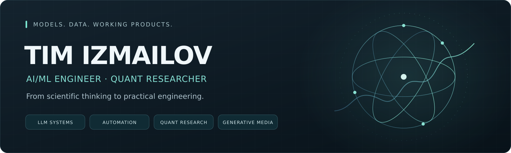
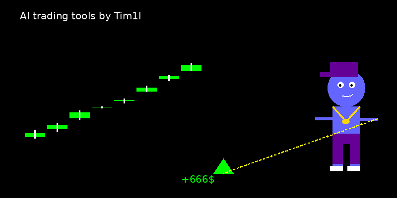

# Tim Izmailov

**CTO · AI/ML Engineer · Quant Researcher**

I lead AI product engineering, automate business operations, and develop software for quantitative research. My work connects technical strategy, hands-on implementation, models, data, and the practical requirements of running a product.

My background combines nuclear physics, data science, and ten years of hands-on trading experience, from Forex to cryptocurrency markets. I work with product teams, business operators, and trading teams on clearly defined engineering and research problems.

  

## CTO — Confidential AI Product (NDA)

Technical leadership and hands-on AI engineering for a product with a **design target of 5 million monthly active users (MAU)**.

- **Technical direction:** lead AI engineering priorities and delivery, with sole responsibility for the product's AI components.
- **AI capabilities:** personally built components covering conversational behavior, memory, multilingual interactions, and image, video, and voice generation.
- **GPU and inference engineering:** model selection, GPU deployment, and inference optimization including KV-cache reuse, balancing quality, response latency, resource requirements, and operating cost.
- **Quality and integration:** established evaluation with human testers and AI agents and coordinated integration with backend and design teams.

## Selected Engineering Experience

- **Business automation:** completed prepaid and postpaid systems covering client account information, calculations, notifications, and administrator workflows.
- **Client trading software:** paid development of a bot for S&P 500 mini and micro futures.
- **Systematic trading:** historical team experience developing automated trading systems for a portfolio of approximately **$330,000**.

## Featured Work

| Project | What it covers |
| --- | --- |
| [LLM Systems Engineering](https://github.com/Tim1l/llm-engineering) | Model selection, behavior, memory and context, multilingual quality, evaluation, and inference performance |
| [Business Automation](https://github.com/Tim1l/business-automation) | Python services, client and administrator interfaces, calculations, notifications, and data integration |
| [Generative Media & GPU Workflows](https://github.com/Tim1l/generative-media) | Image LoRA, visual consistency, image-to-video, voice and audio, and GPU production workflows |
| [Reinforcement Learning Research](https://github.com/Tim1l/rl-btc-trading-agent) | Applied RL research, experimentation, evaluation, and trading-system engineering |
| [Financial Forecasting](https://github.com/Tim1l/crypto_btc_trend_prediction) | Production-deployed forecasting across multiple financial assets, with automated prediction delivery and monitoring |
| [PineCryptoStrategies](https://github.com/Tim1l/PineCryptoStrategies) | TradingView strategies, indicators, and multi-timeframe chart tools |

<b>AI products and operational systems</b>

My conversational AI work includes defining model behavior, refining system instructions, working with memory and multilingual interactions, comparing suitable models, and evaluating quality with people and agents. I also configure and optimize self-hosted inference around GPU and response-time constraints.

For business automation, I translate an operator's recurring work into connected services: collect the information, apply the business rules, give clients access to what they need, and provide administrators with operational controls.

My generative-media work covers image LoRA training and data curation, photo generation and editing, short-video refinement, voice and audio, and GPU deployment. I own technical and creative decisions, output review, and integration.

<b>Quantitative research and trading software</b>

My work spans reinforcement learning, financial forecasting, market-data collection, research tools, and trading automation. My engineering focus includes data quality, walk-forward and out-of-sample evaluation, execution assumptions, monitoring, and repeatable research workflows.

Ten years of manual trading provide market context alongside my software and modeling experience. I am interested in quantitative research roles and contracts that combine research with practical implementation.

## Technical Strengths

| Area | Tools and focus |
| --- | --- |
| Software and automation | Python, PostgreSQL, API integration, Telegram services, Linux deployment |
| Machine learning | PyTorch, TensorFlow, Keras, time-series modeling, reinforcement learning, evaluation |
| LLM systems | Model selection, prompt engineering, conversational behavior, memory, multilingual evaluation, self-hosted inference |
| Generative media | Image LoRA, dataset preparation, image editing, video, voice, audio, and GPU workflows |
| Data engineering | Collection pipelines, quality checks, monitoring, and recovery from source or service failures |
| Trading software | Pine Script, Python trading tools, market-data integration, and research infrastructure |

## Work With Me

- **Build or improve an AI product:** LLM behavior, model selection, evaluation, inference, and generative-media workflows.
- **Automate recurring operations:** client portals, integrations, calculations, reporting, notifications, and administrative tools.
- **Develop quant and data systems:** research software, forecasting components, data infrastructure, and trading automation.

I am open to freelance contracts and quantitative research opportunities. A useful starting brief describes the current process or problem, the desired result, and the constraints that matter to your team.

[Discuss a project on Upwork](https://www.upwork.com/freelancers/~01d554f7011bd884f2) · [Connect on LinkedIn](https://www.linkedin.com/in/tim-izmailov-a53524283/) · [X](https://x.com/tim13l)

Selected work is presented at portfolio level. Client identities, working code, internal model configurations, and private datasets remain confidential.

Trading animation

An illustrative animation from my trading-software portfolio.

