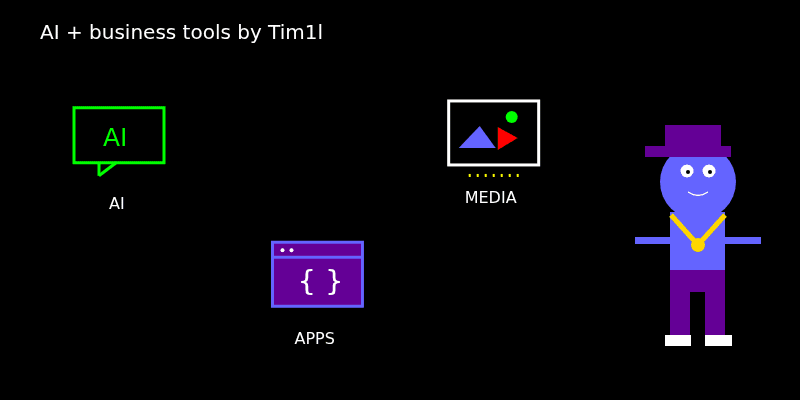

# Tim Izmailov

**CTO · AI/ML Engineer · Quant Researcher**

  

## Products & Business Automation

I independently developed the entire intelligence layer of a confidential platform, from model selection to production integration. **Design target: 5 million monthly active users.**

| Explore | Capabilities |
| --- | --- |
| [LLM Engineering](https://github.com/Tim1l/llm-engineering) | Personality, memory, 8 languages, KV-cache and GPU inference |
| [Custom Software](https://github.com/Tim1l/business-automation) | Connected applications, reporting and process redesign |
| [Generative Media](https://github.com/Tim1l/generative-media) | End-to-end photo, video and audio pipelines; image LoRA |

## Markets & Algorithms

Nuclear physics and **10 years of hands-on trading** underpin an approach centered on **walk-forward testing**, out-of-sample validation and realistic fees and slippage.

| Project | Focus |
| --- | --- |
| [Reinforcement Learning](https://github.com/Tim1l/rl-btc-trading-agent) | Sequential decision agents |
| [Financial Forecasting](https://github.com/Tim1l/crypto_btc_trend_prediction) | Multi-asset deployment and monitoring |
| [Pine Script](https://github.com/Tim1l/PineCryptoStrategies) | TradingView indicators, backtests and execution logic |

**Stack:** Python · PyTorch · TensorFlow · PostgreSQL · APIs.

